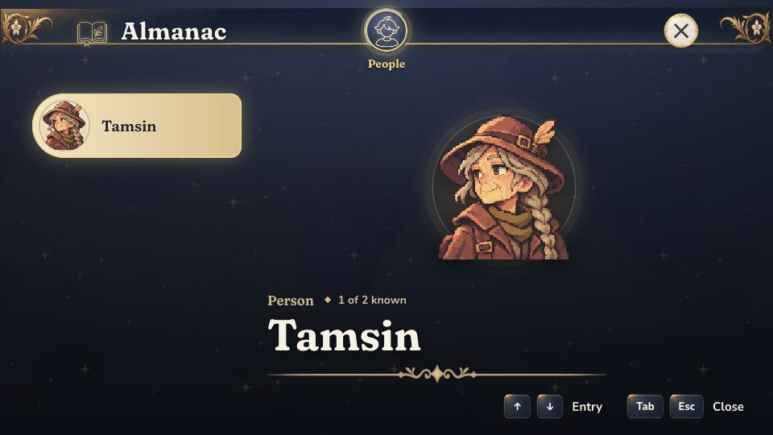

# The Almanac's answers are below the bottom of its page at 960 by 540

Found by the playtest `docs/playtests/2026-11-11-new-player-first-quest.md` (finding 1). Not fixed.

## What happened

Open the Almanac with Tab after the first talk and pick Tamsin. The page shows her portrait and name. The
two headings, "What it needs" and "What it gives", are 73% hidden past the bottom edge of the page's box
and sit under the key hints of the footer. The answers under them are out of sight. The mouse wheel
scrolls them into view, and nothing on the screen says the page scrolls. The mossling's page is the same.

Expected: what a creature needs and gives is the reason to open the book, so it shows without scrolling,
or the page shows that there is more below.

The play tool now says so by itself. `look` on that page prints:

```
cut "What it needs" 332,466 276x36: 73% of it is hidden past the edge of div.gu-panel-body
over "What it gives" 644,466 276x36: text over text: ↑ at 625,489 35x32
```



Not checked at 1366x768 or larger, where the page may be tall enough.

## The recording

```sh
bun tools/play.mjs replay docs/bugs/2026-11-11-almanac-answers-below-the-fold.json
```

It plays the first talk, opens the Almanac, picks People and Tamsin, and expects to read "The Almanac, an
axe and dry advice" without scrolling. Today it fails on that last line. The fix moves the
recording to `tools/play/scenarios/`.
