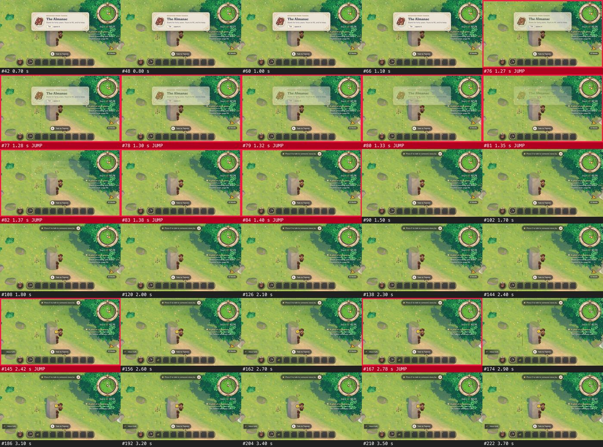

# The first quest's watch step finishes while the hero stands still at the grant stone

Found on 2026-11-11 by playing in human mode at 960x540, seed 7, after a playtester wrote that the
observation "completed during that walk" before they had found a creature. Not fixed.

## What happened

Talk to Tamsin through to the end. The tracker says "Watch a mossling until both columns of its page fill",
already at 1/2. Do nothing. About 2.4 seconds later a "Moss tuft" toast shows, the tracker changes to "Tell
Tamsin what you saw", and a moss tuft is in the bag. The hero never left the stone and no mossling was on
the screen.

Expected: the step waits until the player has walked to the mossy rocks and stayed near a mossling. The
quest is there to teach looking closely (`docs/play/act1.md`), and today it teaches nothing: a new player
is told to watch, and is told they are done before they move.

Happened 3 of 3 replays, and twice more by hand.



## The recording

```sh
bun tools/play.mjs replay docs/bugs/2026-11-11-watch-step-finishes-by-itself.json
```

It plays the first talk with real keys, sees "Watch a mossling" on the tracker, waits 8 seconds without
pressing anything, and expects the tracker to still say it. Today it fails on that last line:

```
Error: "Watch a mossling" was not on the screen within 1000 ms
```

The cause is not read yet. The mossy rocks are within 15 blocks of the stone, so the watch's reach may
simply cover the place the game starts. The fix moves the recording to `tools/play/scenarios/`.
