# Playtest: act 1 for feel, story and look

- **Charter.** Play the act's key moments and judge them as a player would feel them: does each scene land, is the
  world beautiful and grand, is building satisfying, does the loop pull you on. Another tester plays for bugs with
  real keys, so this report names a bug only where it spoils a moment.
- **Build.** The branch `act1` at `57bc71f`, played on `act1-playtest-feel`.
- **How.** `tools/play.mjs` in door mode at 1280x720, ANGLE Metal on an Apple M4. I reached each moment with
  `skipTo`, `teleport` and `setTime`, and filmed the scenes as they played. Three of the repo's own tools drew what
  the door cannot build: `settlement-shots.mjs` (the homestead, the hamlet, the dinner table), `farms-play.mjs` (the
  gearling pit, the terrace, the bait field, the bench) and `fight-world.mjs` (fights 4, 5, 7 and 12).
- **Compared with.** The handbook's chapters 20, 22, 27 and 30, the playthrough site's pictures, and the concept
  sheets in `assets-src/concept/`.
- **Actions.** 84 in the play tool, plus the three tools' runs.

Pictures are in `img/2026-11-12-act1-feel/`. The full-size originals are in `.artifacts/playtest-feel/` in this
worktree, under the same names.

## The short version

The words are the best thing in the act. The film's plates are beautiful, the Custodian, Hobb and the dinner table
are written with real voices, and the farm panel makes a wild farm feel like a machine you tuned. Almost nothing
the words describe is on the screen when they say it. The ground nobody wanted is already a lush meadow. The door in
the hill is a freestanding arch in front of a roofless yard. The Mark rises with the hero's back to the camera. The
blessing is three people by a rock. Hollowmere on market day has nine empty stalls and nobody at them. The act reads
as a strong script played over a pleasant park.

## Moment by moment

### The title and the opening film

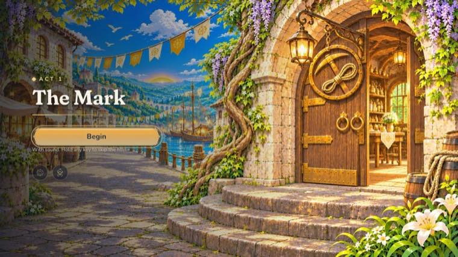 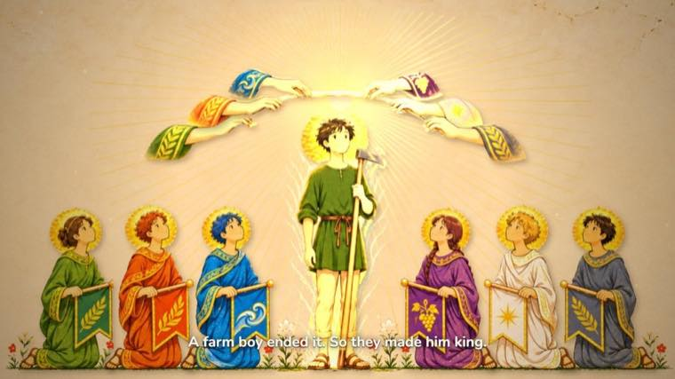

- **Works.** The title painting of the guild door is the best single picture in the game. The mural plates (the war,
  the farm boy crowned, the six friends, the gods asleep, the hand) are rich and read at a glance. The film is short
  enough to watch twice.
- **Does not.** The captions are white on cream parchment. On the mural plates they almost vanish (`02-film-king`).
  In door mode the clock ran between my commands, so I saw the last three shots (the wall, the doorstep in the rain,
  sixteen years on) as plates only (`ref-doorstep`). They match the title's painting and should land.
- **The one change.** Give the captions a dark band or a dark ink on the light plates.

### Grant day at Saltgate

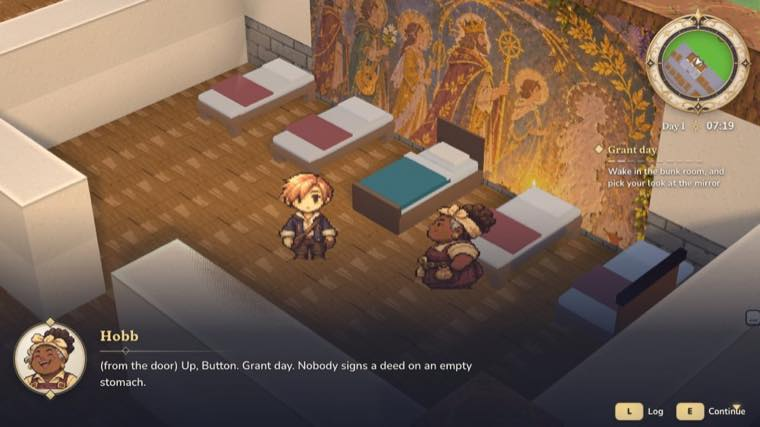 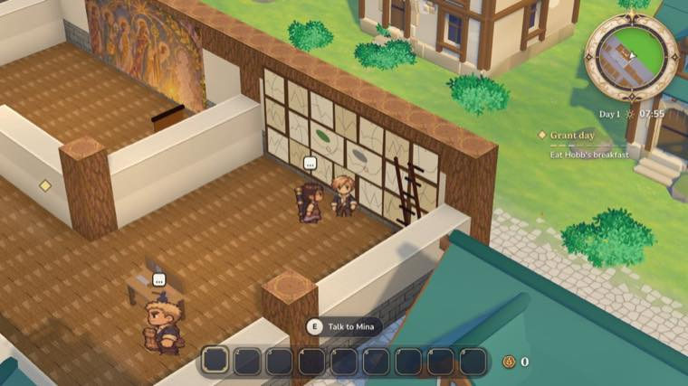 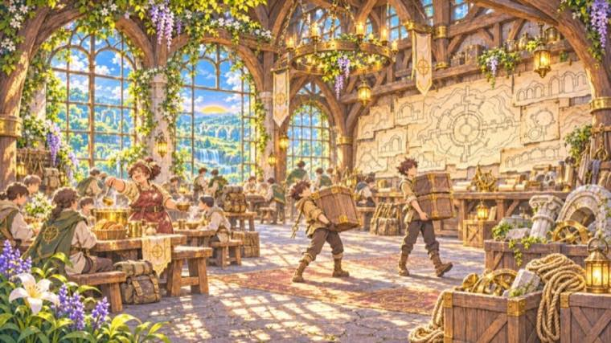

- **Works.** The painted wall in the bunk room carries over from the film, and Hobb's first line ("Nobody signs a deed
  on an empty stomach") sets her up in one sentence.
- **Does not.** The cut from the film's painted harbour to the bunk room is the biggest drop in the act. The rooms
  are white boxes with bark-textured posts, the beds are plain blocks, and the guild hall holds three people. The
  playthrough's hall (`ref-hall`) is lit, crowded and full of crates. The quay is a grey strip with lily pads, a
  rowboat with a mast for a ferry, and piling tops with no deck (`05-quay`). The title promised a port city.
- **The one change.** Furnish the guild hall and fill it with guild members, so the first room after the film looks
  like the title.

### The landing and the first day

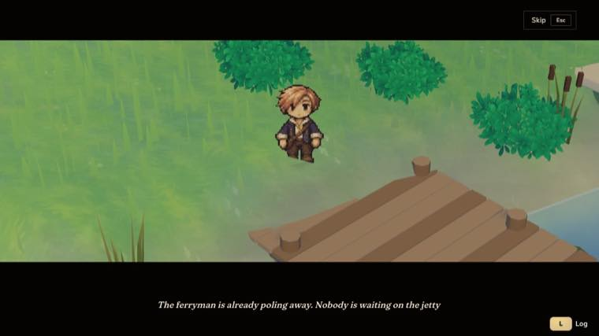 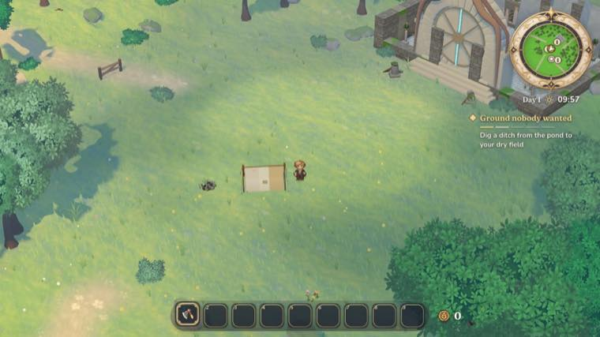 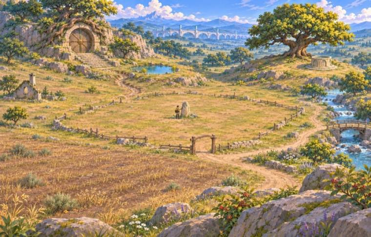

- **Works.** The letterboxed scene and the jetty by the weir are a calm arrival.
- **Does not.** Scene 7's first line ("The ferryman is already poling away") plays over a close-up of grass with no
  ferry in it. The plot is a lush green meadow, the same as everywhere else. The concept (`ref-home-tired`) and the
  quest ("Dig a ditch from the pond to your dry field") ask for straw-coloured ground that turns green where the
  water goes. That is the act's first lesson, and with green everywhere there is nothing for the water to change.
- **The one change.** Make the plot and the land round it tired and dry until water reaches it.

### The door by day and the first night

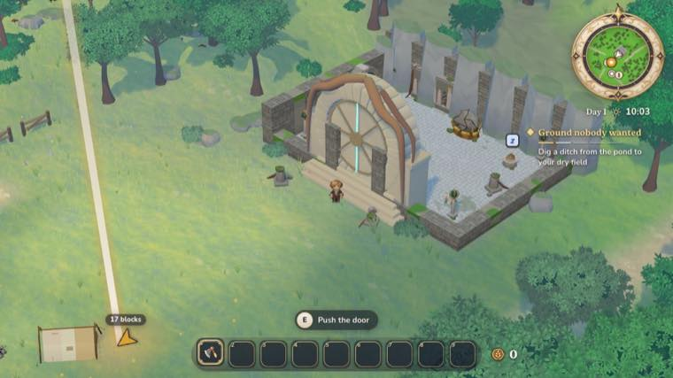 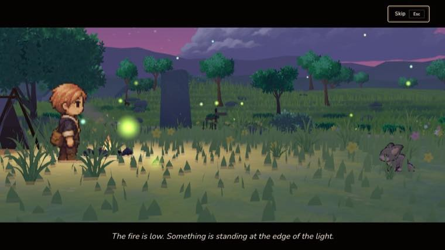 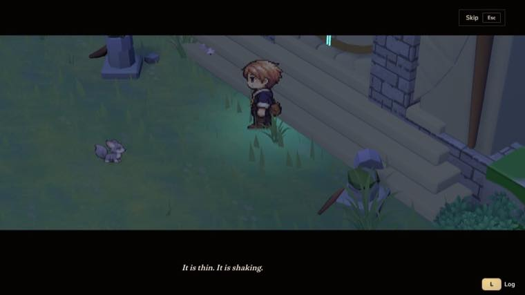 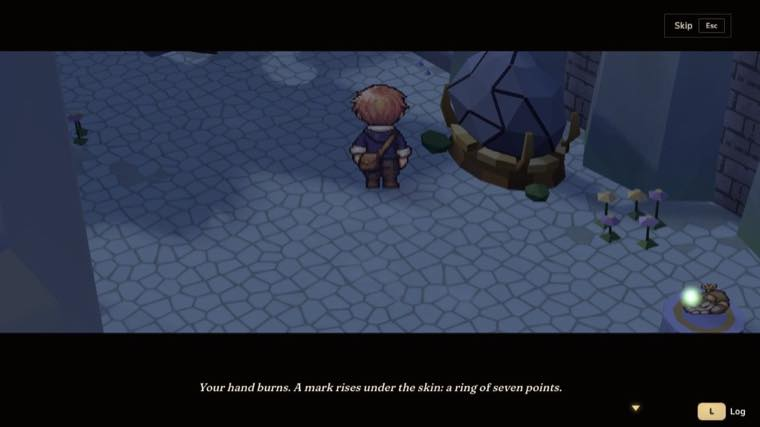

- **Works.** The dusk shot of scene 9 (`11-night-low`) is the most beautiful moment in the 3D game: a low camera, a
  purple sky, fireflies, the standing stone, the fox at the edge of the light. The firelit circle seen from above
  (`12-night-top`) is good too.
- **Does not.** The shut door is not in a hill. It is a freestanding arch in front of a walled yard with no roof, and
  from the plot you can see over the wall to the Heartstone and the Custodian's plinth (`09-door-day`). A door that
  has never opened means little when the room behind it is in plain view. Scene 9 shows the fox close up and cute
  (`10-night-fox-reveal`) before the line says "Something is standing at the edge of the light", so the reveal is
  spent. In scene 10 the hero stands on the side steps, not with their back to the door, holds no raised weapon, and
  the fox is a small calm shape far off (`13-door-scene`). In scene 11 "Lamps wake along the walls" plays in a dark
  blue yard where no lamp lights, and "Your hand burns. A mark rises under the skin" plays with the hero's back to
  the camera and no glow (`14-mark`). The act is called The Mark, and the Mark is never shown.
- **The one change.** Put the Hall inside the hill, roofed and dark, and give scene 11 a close shot of the hand
  lighting up as the lamps wake one by one.

### "You're late" and the Heartstone

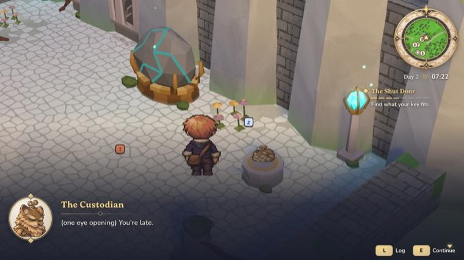 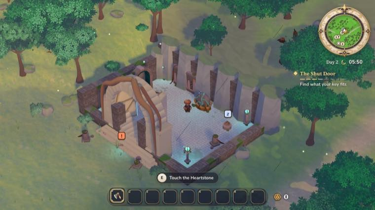

- **Works.** The Custodian's lines are the best writing in the act ("A thousand years and sixty-one days late. I
  counted. There was nothing else to do."). Its portrait, a grumpy cat of moss and brass with a wind-up key, is
  exactly right. The Heartstone with teal veins reads as a thing of power.
- **Does not.** In the world the Custodian is a brown lump about thirty pixels wide on a plinth, and its eye never
  opens. The camera stays at play height. The sleeping "z" marker stays over the hero after it wakes. The stage cue
  "(one eye opening)" is printed in the box instead of being shown, as are "(from the door)" for Hobb and "(out of
  breath)" for Aldric.
- **The one change.** Frame the Custodian close for scene 12, with a sprite big enough to open an eye.

### The blessing and the pump

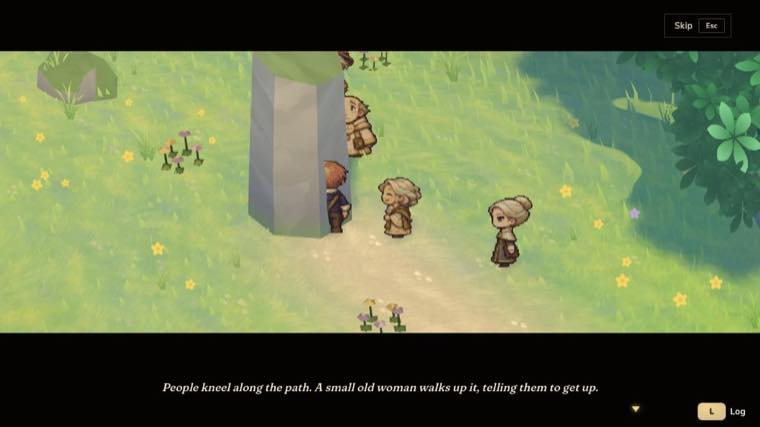 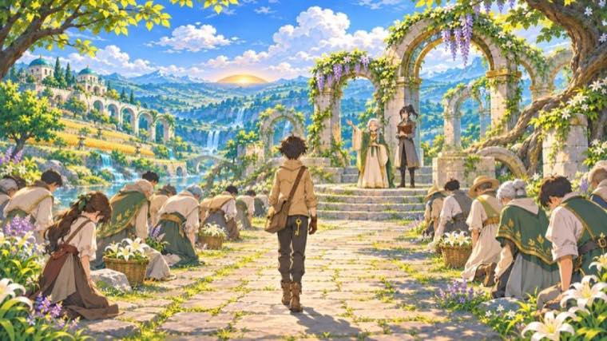 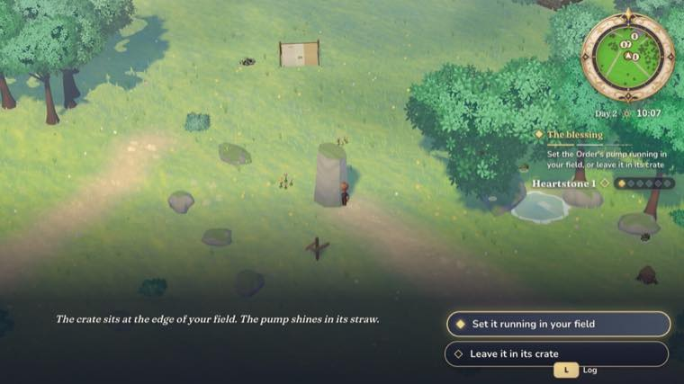 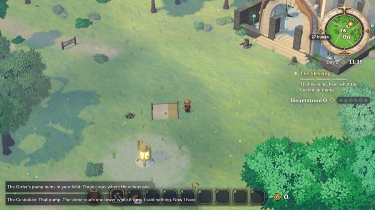

- **Works.** The Green Mother's lines are warm and a little wrong ("People forget they may say no to me"). Once the
  pump runs, the grey ring round it and the Heartstone gauge falling from 1 to 0 tell the cost without a word
  (`19-pump-field`). That is the act's best use of the picture to tell the story.
- **Does not.** "People kneel along the path" plays over three villagers standing by the grant stone, with the hero
  hidden behind it (`17-blessing`). The playthrough's picture (`ref-blessing`) is a kneeling crowd on a path of
  arches. The head of the Order looks like any other old woman in the town. The act's first real choice, the pump,
  comes up in an empty meadow with no crate, no pump and nobody there (`18-pump-choice`).
- **The one change.** Stage the blessing: the crowd kneeling, the Green Mother walking up the path, the novices and
  the crate on screen when the choice is asked.

### Hobb and Dax, the kitchen, the homestead and the hamlet

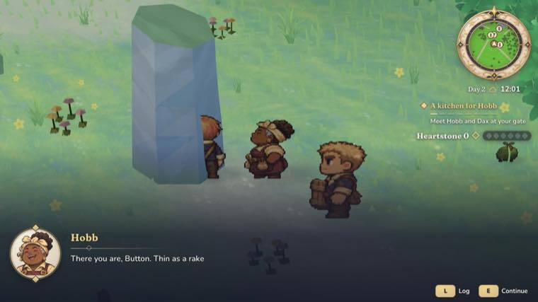 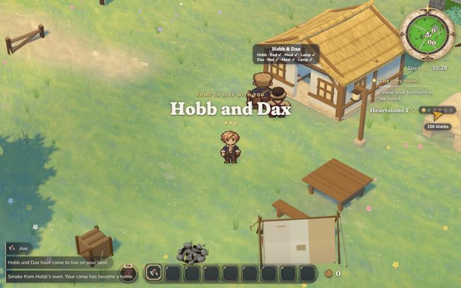 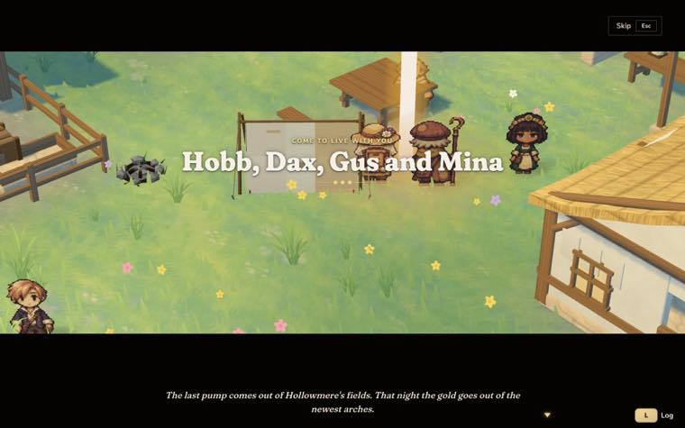 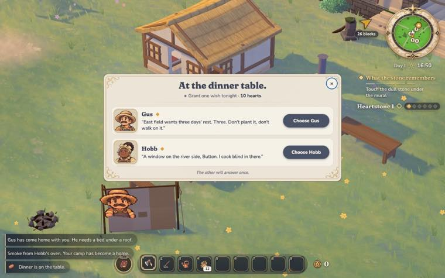

- **Works.** Hobb's reunion is the warmest scene ("A miracle, they tell me. Miracles still eat breakfast."). The
  "Come to live with you" card is a good beat. The thatched cottage is close to the settlement concept and the first
  building that feels like home. The dinner table panel, two wishes and one grant, is clear and touching.
- **Does not.** The hero stands behind the grant stone in the reunion as well. That is the third scene at the stone,
  and every one of them hides the hero. Dax carries a small barrel, not "a crate the size of a door". At the hamlet
  the tent and the fire pit are still in the middle of the plot. The settler card lands on top of a scene caption,
  so two titles fight (`22-hamlet`). `skipTo` builds nothing, so a quest skipped to shows a bare plot; I judged the
  homestead from the settlement tool's pictures.
- **The one change.** Take the tent and fire pit away once the first home stands, so each stage of the plot looks
  different from a distance.

### The grey wood and the boar

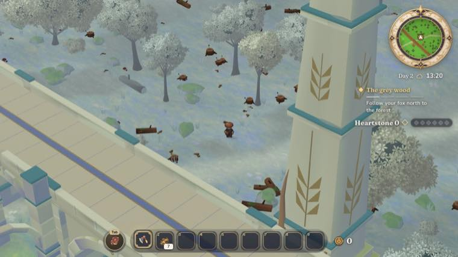 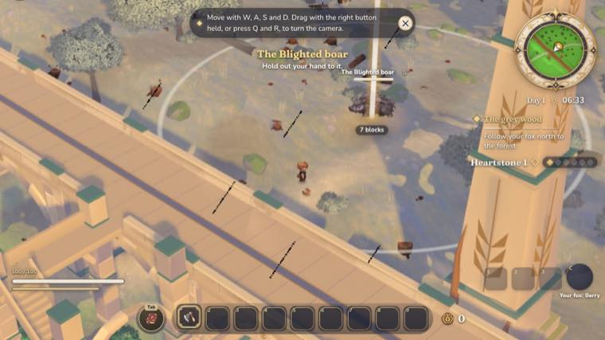

- **Works.** The grey wood under the piers of the High Road is the clearest piece of world-telling: the colour drains
  out where the gold road runs, and the gold wheat on the pier says who built it.
- **Does not.** The boar Wren says is "as big as a cart" is a grey lump the size of a rock (`25-boar`). Wren is not
  there when the fight starts. Stumps are scattered over the ground like litter.
- **The one change.** Draw the boar at its size, so "not yet" looks like a beast you could not have fought.

### Hollowmere and market day

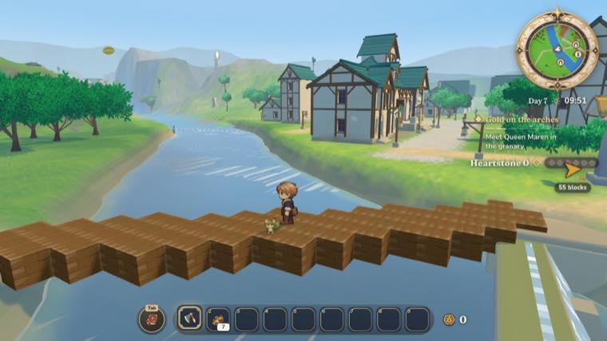 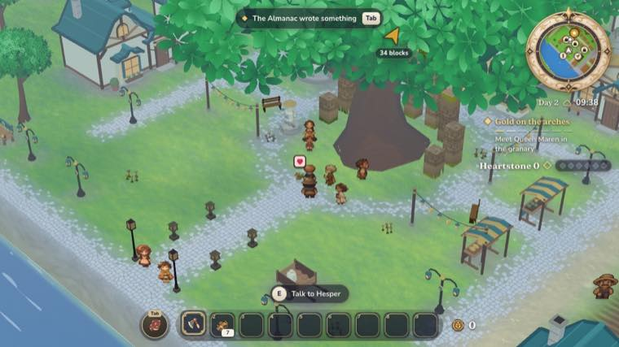 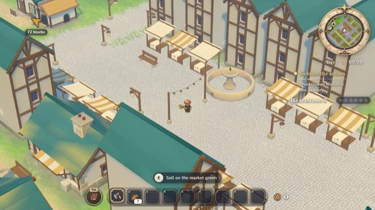 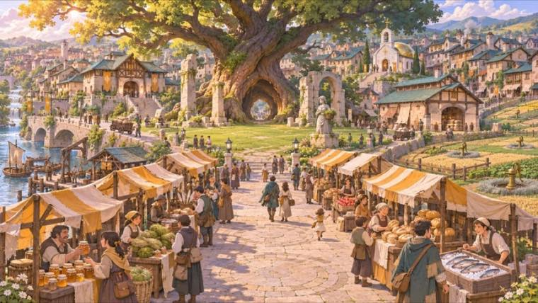

- **Works.** The tall half-timbered houses with teal roofs are handsome, and the Hollow Oak in the square is a good
  heart for a town.
- **Does not.** From the bridge the city reads as a village: one cluster of houses by the river, with no wall, no
  chapel on a rise and no roofs climbing behind it (`29-bridge`). The bridge is a zigzag of wooden blocks, the most
  Minecraft-looking thing in the act. The town gate is one brick pillar in a hedge (`27-town-gate`). On day 7,
  market day, the market has nine stalls round a fountain and not one seller, good or buyer (`28-market-day`); the
  concept (`ref-marketday`) is a packed street. In the code only the goods panel reads market day; no view changes
  the town for it. The prompt there says "Sell on the market green" in a stone plaza.
- **The one change.** Fill the market: sellers at the stalls, goods on them, and a crowd that doubles on market day.

### The lit arches and the lynx

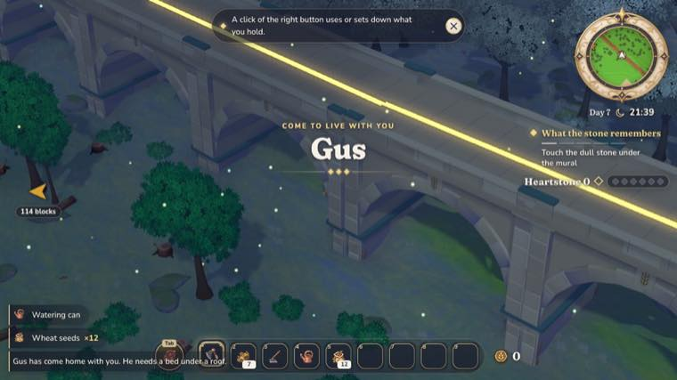 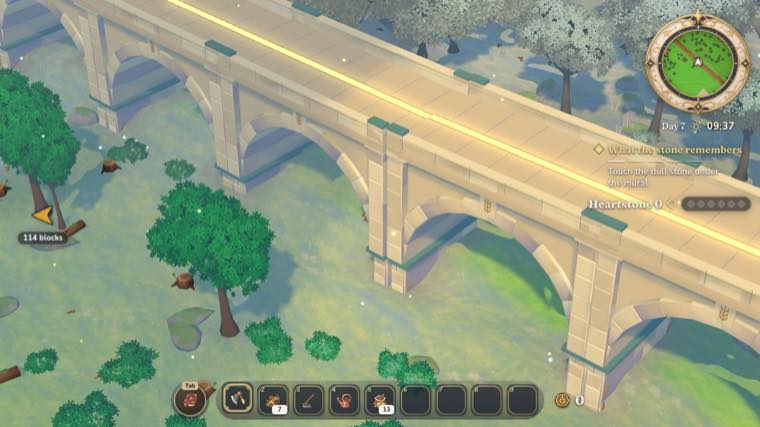 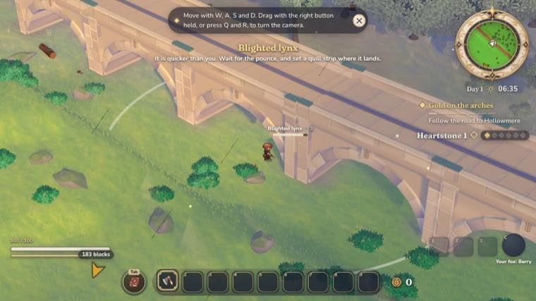

- **Works.** The aqueduct by day is the grandest built thing in the valley.
- **Does not.** "Gold runs along the tops of the arches" is a thin yellow line along the parapet, which reads as a
  waypoint line, not as light (`30-arches-lit-night`). The grass under it is only a little paler (`31-arches-day`),
  so "by morning the land under it was grey" does not show. The lynx fight runs in daylight, and the lynx is a small
  brown dot beside a rock (`32-lynx`). The fight tool's run of fight 5 did not end won.
- **The one change.** Light the arch tops so they glow and throw gold on the stone, and turn the ground under them
  plainly grey.

### A vault

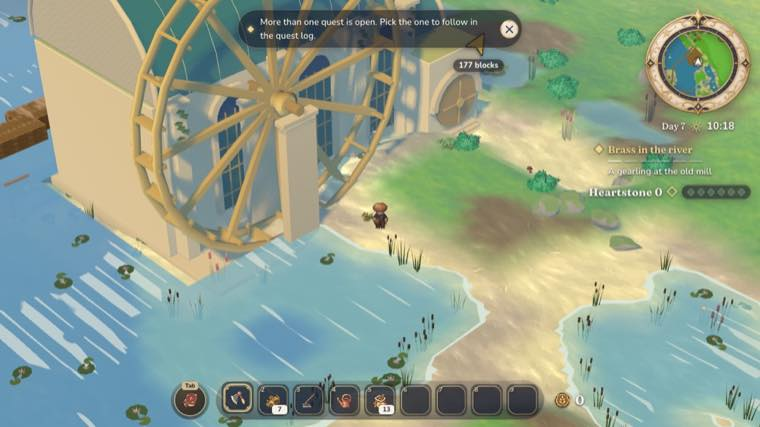 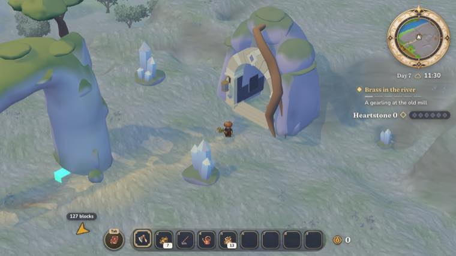 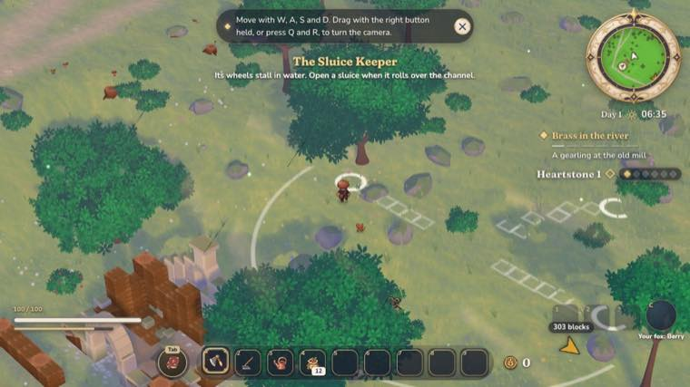

- **Works.** The Pump House is a real landmark: a big golden wheel against a domed hall on the marsh. The Lamp
  Gallery's cave mouth in lilac rock with crystals is charming.
- **Does not.** There is no inside to any vault. `src/game/ruins` is still the foundation stub, so there are no
  half-flooded halls, keystones or memory stones. The Sluice Keeper is fought in an open meadow with its channel
  drawn as chalk squares on the grass (`34-sluice-keeper`). At the Seed Vault the camera shows only leaves, and the
  hero is hidden under the canopy (`36-seedvault`).
- **The one change.** Build one vault inside, the Pump House, and fight its keeper there.

### The terrace, the farms, the bench and the ledger

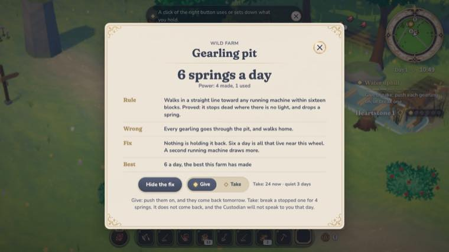 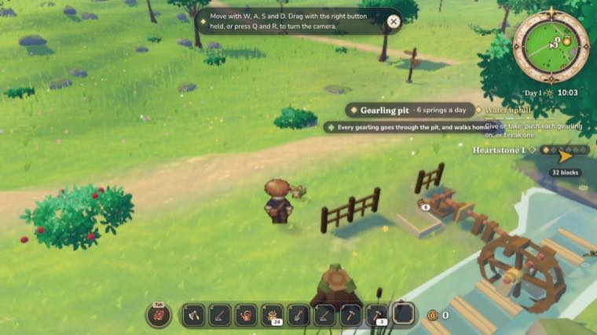 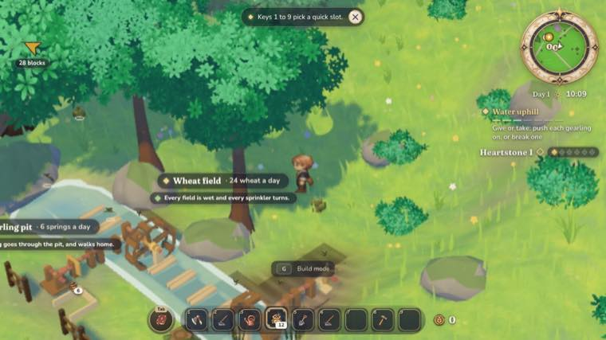 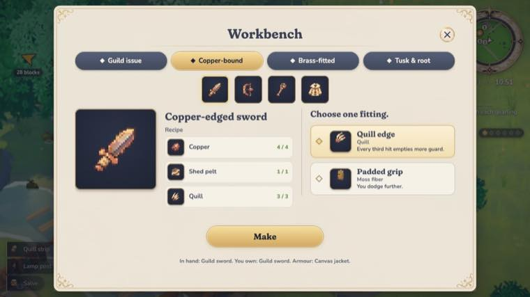

- **Works.** This is the part closest to what Kausthubh asked for. The farm panel gives each farm a rule, what is
  wrong, the fix, the best rate, and give or take with its cost (`44-farm-panel`). It feels like tuning a Minecraft
  mob farm. The tag over each farm ("Gearling pit · 6 springs a day") keeps the number in the world. The bench shows
  each recipe with what you have, and asks for one fitting with a real trade (`45-bench`).
- **Does not.** In the world the farms are small and easy to miss. The gearling pit is a strip of little wooden parts
  in a channel, and the gearlings are hard to pick out (`41-farm-pit`). The terrace's tag says "24 wheat a day" over
  grass and a tree, with no wheat in view (`42-terrace-farm`). The bait field sits under a tree canopy at night
  (`43-bait-night`). The panel's heading "Wrong" sits over "Every gearling goes through the pit", which is the farm
  working. The Tab book is titled "Almanac" though the hint and the Custodian call it the field book, it has no Build
  tab, and it says "2 of 4 known" beside a list of one (`40-almanac`). I did not reach the ledger panel or scene 27.
- **The one change.** Make a working farm readable from the game's camera: crops standing in the terrace, parts at
  a size you can see move, and no farm under a canopy.

### The terraces, the Rootworks and the Stag

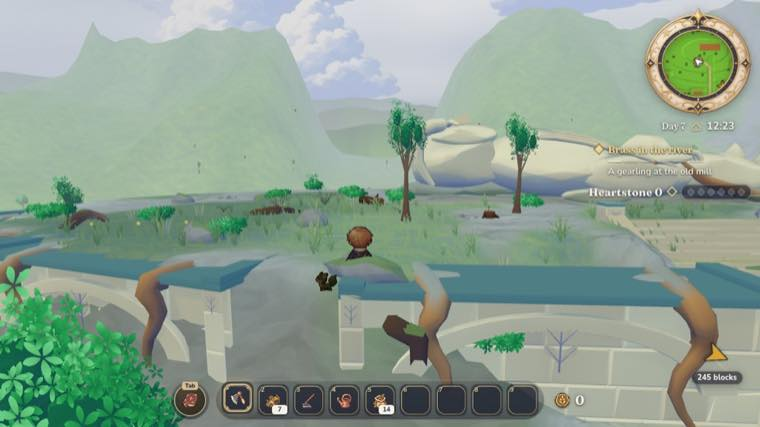 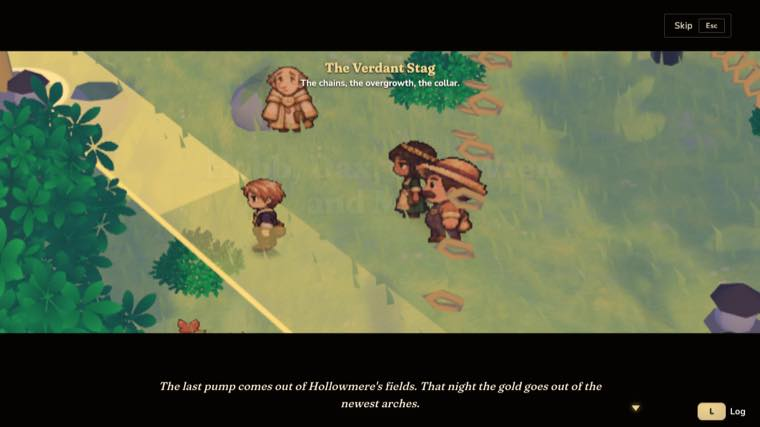

- **Works.** The arched retaining walls wrapped in roots point the right way.
- **Does not.** The terraces are a few low walls on a grey-blue field (`37-terraces`, `38-terraces-low`), with no
  round gate and no sense of a great ruin. The Rootworks does not exist. The Stag fight, started by the fight tool,
  opens near the home plot with no Stag on screen, and three texts stacked on each other: the fight's title, a faded
  settler card and a caption about the pumps (`39-stag`). The tool's run did not end won.
- **The one change.** Build the god before the fight: a Stag as tall as an oak, standing in chains on the terraces.

## The ten changes that would most raise the act

Ranked by how much of the act each one lifts. The owner is the builder in `docs/act1-foundation.md`.

| # | Change | Why it ranks here | Owner |
|---|---|---|---|
| 1 | Show the scenes' words on the screen: the blessing's kneeling crowd and crate, the lamps waking and the hand glowing in scene 11, the Custodian's eye in scene 12, the hero's back to the door in scene 10, the ferry leaving in scene 7. Frame each with its subject, and never stand the hero behind the grant stone. Show the stage cues or drop them; never print them. | Every scene in the act tells instead of shows today, and the best writing in the game plays over pictures that contradict it. | Quests and scenes (the film director), with dialogue for the cues |
| 2 | Put Ilara's Hall inside the hill: a sealed door in a hillside, a roofed room that stays dark until the lamps wake. | The act's title moment, the door that opens for you, has no mystery while the room behind it is open to the sky and in plain view. | The world (the hill), people and settlement (the Hall's look) |
| 3 | Make the plot and its valley tired: straw ground, dry stalks and grey hedges that turn green where water and care reach. | "Where you send water, the ground comes back to life" is the first lesson and the whole engine of the Heartstone, and a lush meadow cannot show it. | The world, with farms for the wet ground |
| 4 | Fill Hollowmere: people in the square, sellers and goods at every stall, twice the crowd on market day. | The "real kingdom feel" he asked for depends on people more than on buildings, and market day is the act's one recurring town event. | People and settlement (routines), goods (market day) |
| 5 | Make Hollowmere a city from outside: a wall and a gate, the chapel on a rise, roofs climbing behind the square, a stone bridge in place of the block steps. | "The city reads as a village from the bridge" (`29-bridge`). This is the grand-scale picture he asked for. | The world |
| 6 | Draw the act's beasts at their size: the boar as big as a cart, a Custodian that can open an eye, a lynx you can see, a Blighted fox that looks hungry rather than cute when it first appears. | Fights 1, 4 and 5 and scene 12 all depend on a creature reading at a glance, and today they read as props. | Fights (creatures), with the `make-sprite` skill |
| 7 | Build the vaults and the Rootworks inside, and fight the keepers and the Stag where they live. | Chapters 3 and 4, half the act, have no interiors; the ruins system is still a stub. | Ruins, with the world |
| 8 | Make a running farm read from the game's camera: crops standing in the field, parts big enough to see turning, creatures you can follow, no farm under a canopy. | The engineering loop is the act's best system, and in the world its result is nearly invisible. | Farms and machines |
| 9 | Light the gold road for real, a glow along the arch tops that lights the stone, and plainly grey ground under it. | The Order's one visible harm in chapter 2 is a thin line today. | The world (the arches), goods (the pumps' grey) |
| 10 | Bring Saltgate up to the title painting: a full guild hall, a ferry that is a ferry, a jetty with a deck, ships at the quay. | It is the first room after the film, and the drop from painting to white boxes is the first thing a new player feels. | The opening |

## Smaller things noticed

- Text layers collide: the settler card over a scene caption (`22-hamlet`, `39-stag`), the message log over the
  quick slots (`19-pump-field`), the "Log" button over the second choice (`18-pump-choice`).
- The film captions are hard to read on the light plates.
- The free camera clips into tree canopies (`36-seedvault`), and the camera's reach is too short to see a place from
  a hill. A "look out" key would help both the player and the testers.
- Stray dotted black lines still cross the ground in the fight pictures (`25-boar`).

## Not reached

- The ditch and the green spreading from it, the kitchen and the moss pen built by hand. `skipTo` builds nothing.
- The lynx at night under the lit arches. The fight runs by day, and the tool's run did not win it.
- Any vault's inside, the keystones, the memory stones and the Rootworks. `src/game/ruins` is a stub.
- The Verdant Stag itself. Fight 12 starts with no Stag on screen.
- The queen's ledger panel and scene 27 on the terrace.
- Scenes 20 and 21 with Wren, and the film's last three shots as they play. I saw those three as plates.

`bun run check` failed on `act1` as I found it, before this playtest: two tests in `src/game/goods/goods.test.ts`
(the granary cap after a ledger section), the `goods-market-day` scenario (no "Sell on the market green" prompt
where it expects one), and two prop tests that timed out under load.
