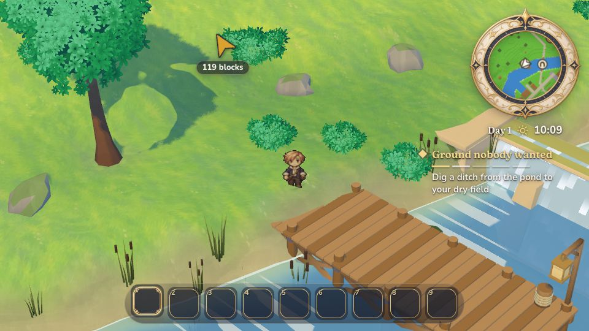
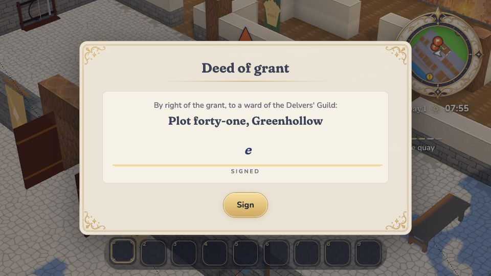
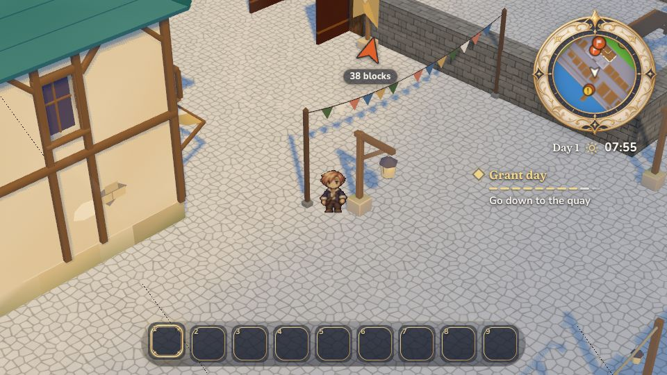
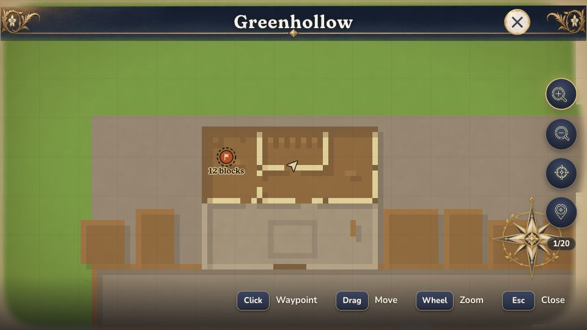
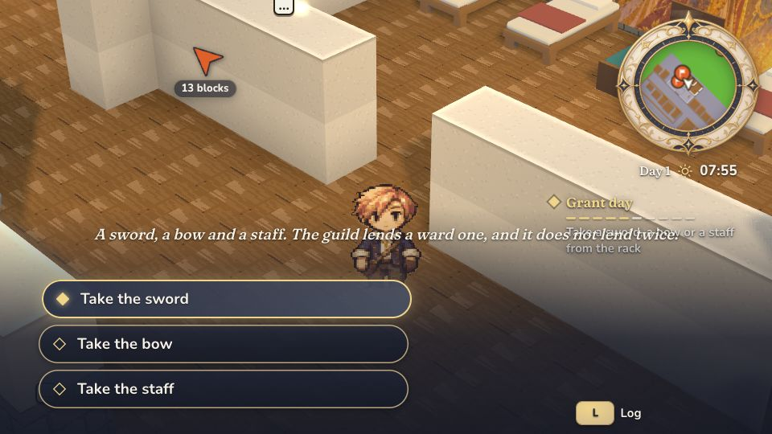
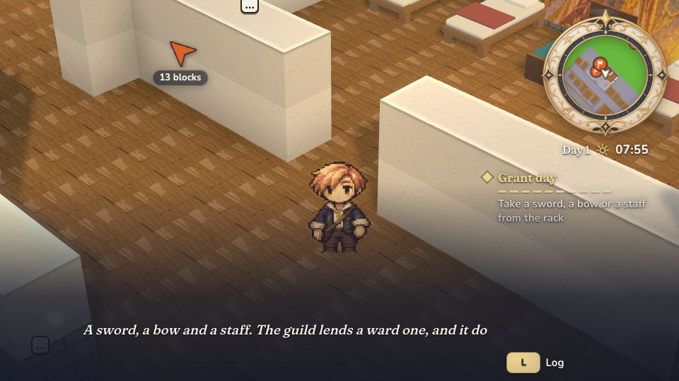

# Playtest: grant day at Saltgate and the ferry, from a new game

- **Charter.** A new game from the title through the film, grant day at Saltgate, the ferry and the landing, then
  on to the first night. Played on `act1-integrate-2`, after the opening, fights, world and polish branches merged.
- **Player.** Hurried and New: real keys and clicks only (`--mode human`, not blind), 960x540.
- **Renderer.** ANGLE Metal, Apple M4.
- **Actions.** 52. The first night was not reached: grant day and the ferry took the whole budget, most of it
  walking through Saltgate's guild hall.

The pictures are in `img/2026-11-12-grant-day/`, with every note in `notes.md` there.

## What works

The title shows Begin, the film plays its painted layers with captions and skips on a held key, Hobb wakes the hero
under the painted wall, and every step of grant day plays by walking up and pressing E: the porridge, Dax's lock,
Mina's map wall, the rack's three weapons, the bout (three swings with F, a camera punch on each), the grant and the
deed, the goodbyes at the quay, the four shots up the river and scene 7 at the landing. Quest 2 starts after it.

## Findings, worst for a player first

1. **Bug, fixed in this branch: no axe after grant day played.** At the landing the bag was empty. `skipTo('ground')`
   gives the guild's axe and playing grant day gave nothing (0 axes, checked with the rules). The opening now gives
   it as the ferry lands, and `grant-day` checks it. The ditch step still has no spade in the bag
   ().
2. **Bug: E types into the deed.** Pressing E to continue the Guildmaster's lines, as the box says, typed `e` into
   the deed's name field as it opened. The tracker said "Go down to the quay" before the deed was signed
   ().
3. **Hard to find the way.** Leaving the bunk room, the hall and the guild yard took about twenty of the 52 actions.
   Walls hide the hero (a dither hole shows them), the yard's gate is out of view, and the rack and the quay have no
   marker in the world; the lock and the map wall had a `!` on the minimap only
   (, ).
4. **Bug: the narrator's line sits on the tracker** when the rack's three choices are up
   ().
5. **Bug: the first river shot cuts to the inside of a wood** for about 0.2 s before it settles (film 050, 3.08 to
   3.28 s), and **a house front pops** over the street for one frame twice on the walk to the quay (film 048).
   The green banner by the bunk room blinks out and back for single frames as the hero passes it (film 021).
6. **The rack's choice opened from the hall**, about 13 blocks from the rack, with the camera zoomed right in
   ().
7. **The words do not match the picture.** "Dax at a table of locks" plays with no Dax and no table on the screen;
   the Pump House shot's "a sealed door ... delvers packing their picks" shows a plain box with a wheel; Hobb says
   "Breakfast first" after the porridge is eaten.
8. **Smaller.** The mirror step is done without the mirror; the map is titled Greenhollow in Saltgate; the first
   Escape after a waypoint leaves the map open; Dax stands under the quick slots when the bout starts; the crowd
   vanishes in one frame when the deed is signed; the staff taken from the rack is in neither hand nor bag; the
   clock stands at 07:55 from the rack to the quay; thin dotted lines cross the hall.

## Not reached

The first night: the ditch, the hut, the fox, the door, the Mark, the Custodian and the Heartstone. The rules play
it in `bun tools/sim.ts scenarios first-night`, which passes. None of the bugs above has its own failing recording
yet; the next tester or builder writes those with the `test-game` skill before fixing them.
