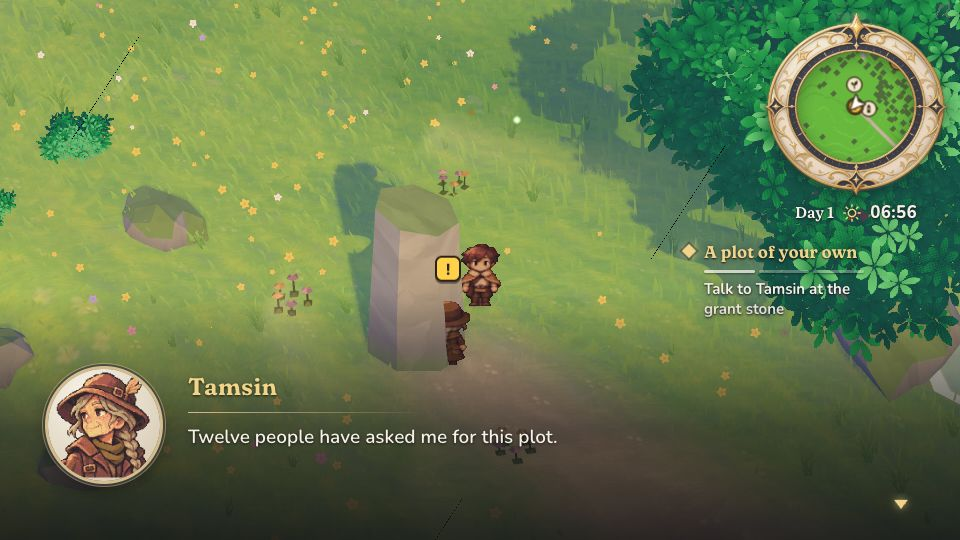
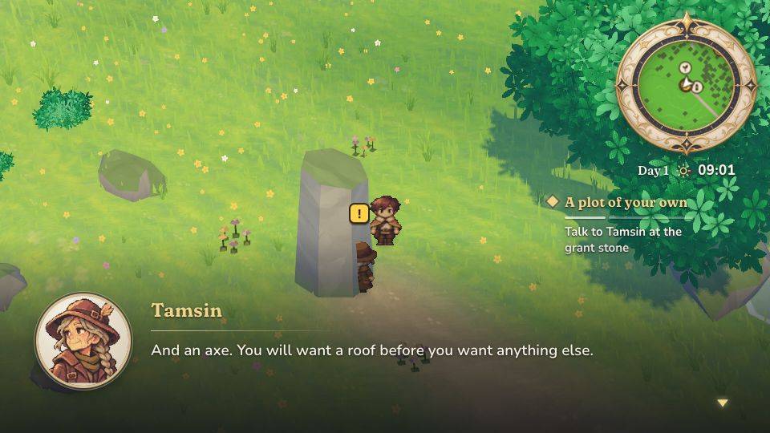
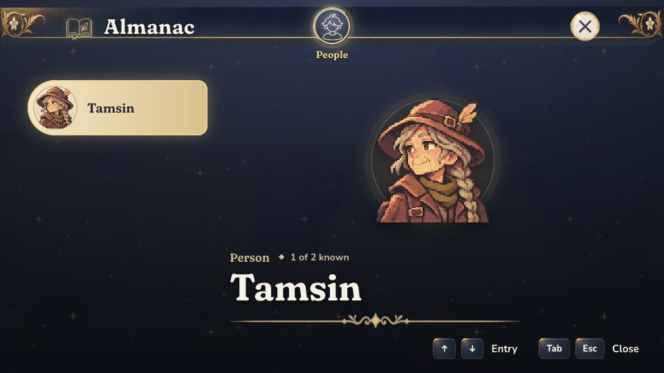
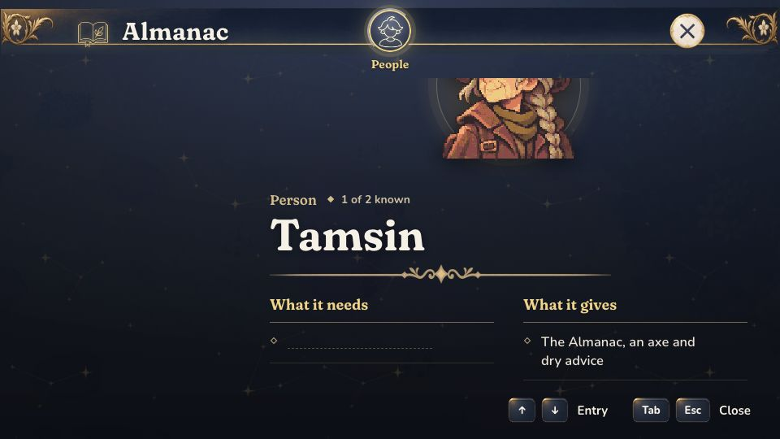
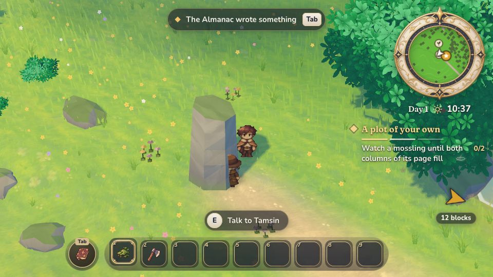
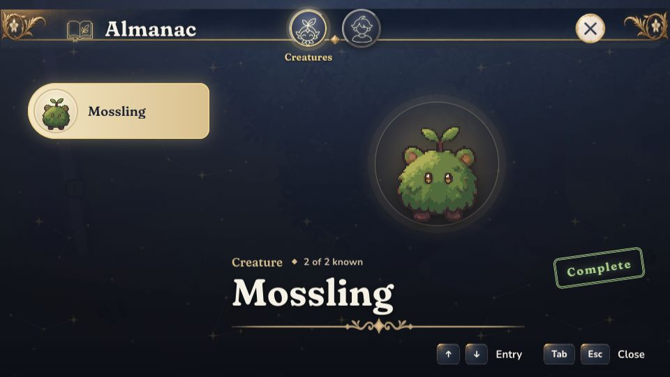
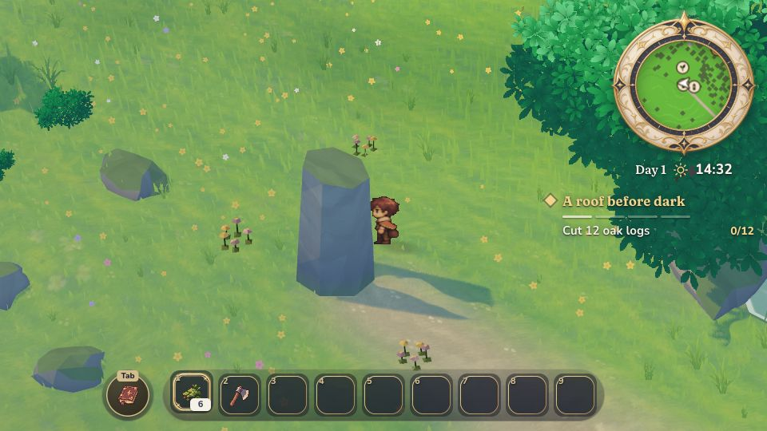
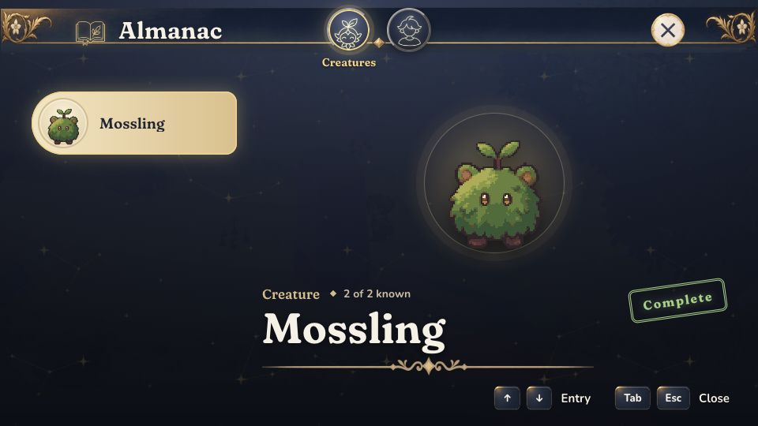

# Notes from 2026-11-11T23-56-23

- **question** Tamsin dialogue has no visible continue key or button after the sentence finishes. I will try Enter.
  
- **polish** Thin dark dashed diagonal lines cross the grass and grant stone throughout the opening conversation. They move between pictures and look like rendering seams.
  
- **bug** At default 960x540 the Almanac fills the screen with a huge portrait. What it needs and What it gives are below the footer; Tamsin entry text is below the viewport. I cannot read the page.
  
- **polish** Scrolling reveals the two columns, but no scrollbar or scroll hint made that apparent at first. The Tamsin list row scrolls under the fixed Almanac heading.
  
- **polish** The map opens zoomed far out with many unknown question marks. No pond label helps me follow Tamsin instruction; I will use the world arrow instead.
  
- **question** Correction to previous map note: on closer reading the map DOES label Mossy rocks, overlapped by the 12 blocks marker. There are no unknown question marks. Quest advanced to 1/2 while I stood at the grant stone.
  
- **bug** Mossling page repeats the Almanac clipping: both filled column answers are below the screen, so Complete is visible but what I learned is not. Hero also disappeared under the tree during the filmed walk.
  
- **polish** First quest completed; tracker now says A roof before dark. I finished observation while walking under dense leaves, without deliberately identifying or watching the mossling. Its completed page explained what happened.
  
- **bug** Tool bug: see Shade and mossy stone succeeds although the answer is completely hidden below the Almanac footer. Screen list reports y536, height23, outside the readable content area.
  
