# Notes from 2026-11-12T10-25-41

- **question** After Hobb wakes the hero, the tracker step "Wake in the bunk room, and pick your look at the mirror" is done and moves on to breakfast without the mirror being touched: the mirror reads as required but is not  
  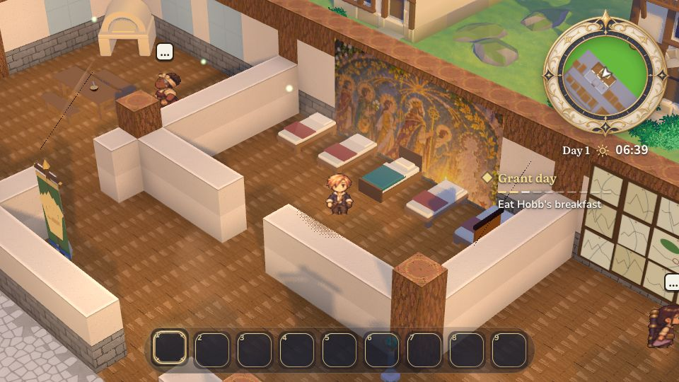
- **polish** Thin dotted dark lines cross the bunk room at an angle (left wall by the banner, by the hero, right by the far bunk): read as stray lines  
  
- **polish** After clicking a waypoint on the full map, the first Escape leaves the map open; the second closes it. The footer says Esc Close.  
  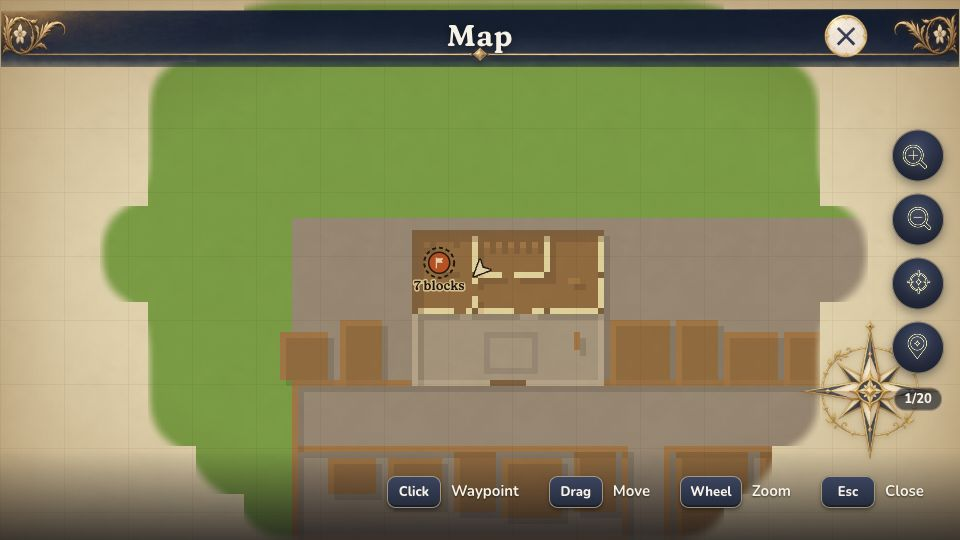
- **polish** Hobb says "Breakfast first. That deed's not going anywhere." right after the hero has eaten the porridge and the step is done: the line reads as before the meal, not after  
  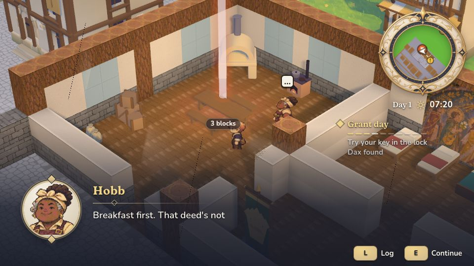
- **polish** The full map is titled "Greenhollow" while the hero is in Saltgate, 1,500 blocks south of it  
  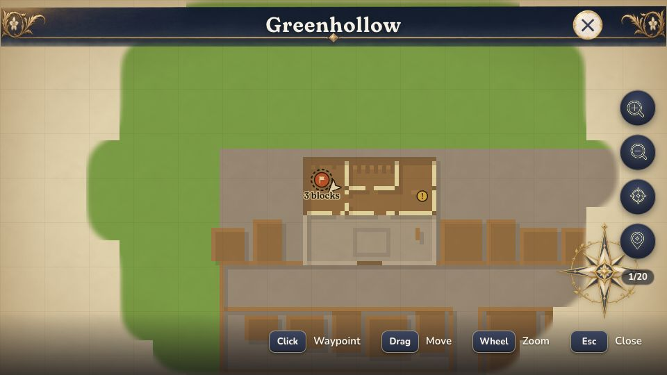
- **bug** Walking east past the green banner by the bunk room, the banner blinks out and back for single frames over about half a second (film 021, frames 96-109): it is there in one frame and gone in the next while the hero walks beside it  
  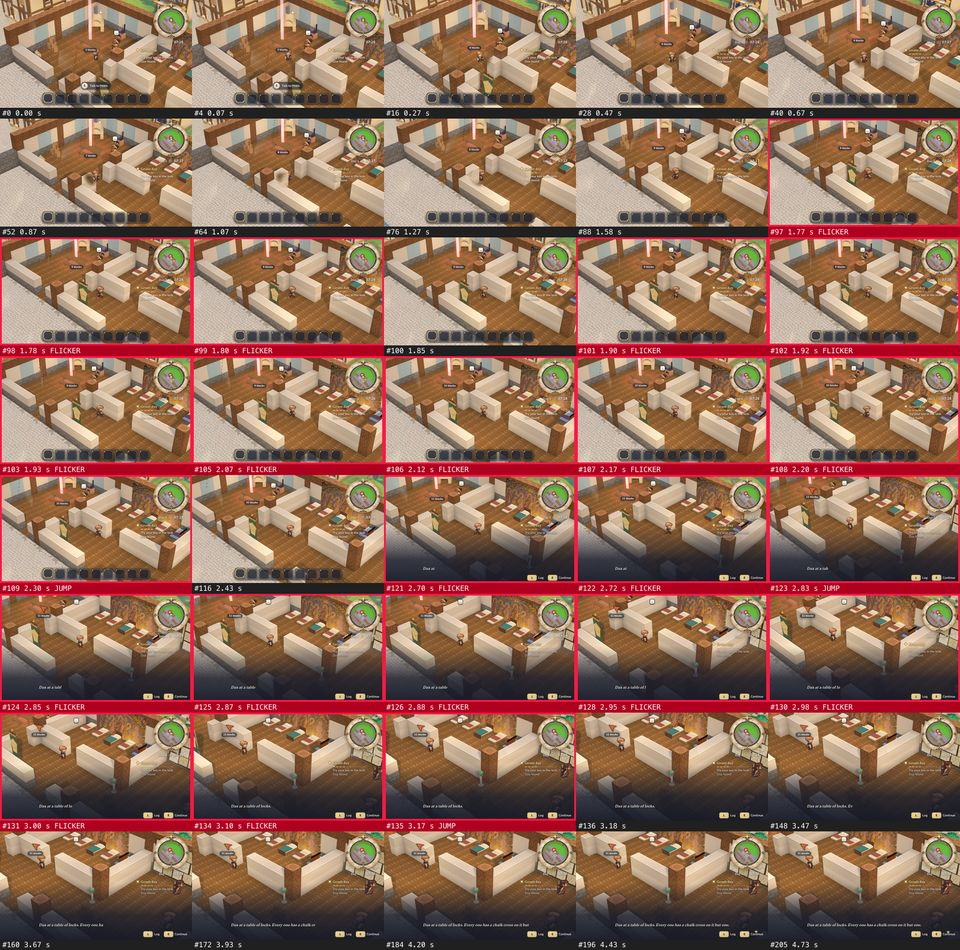
- **question** The lock scene says "Dax at a table of locks", but no Dax and no table of locks is on the screen while it plays: the hero stands in the empty middle room  
  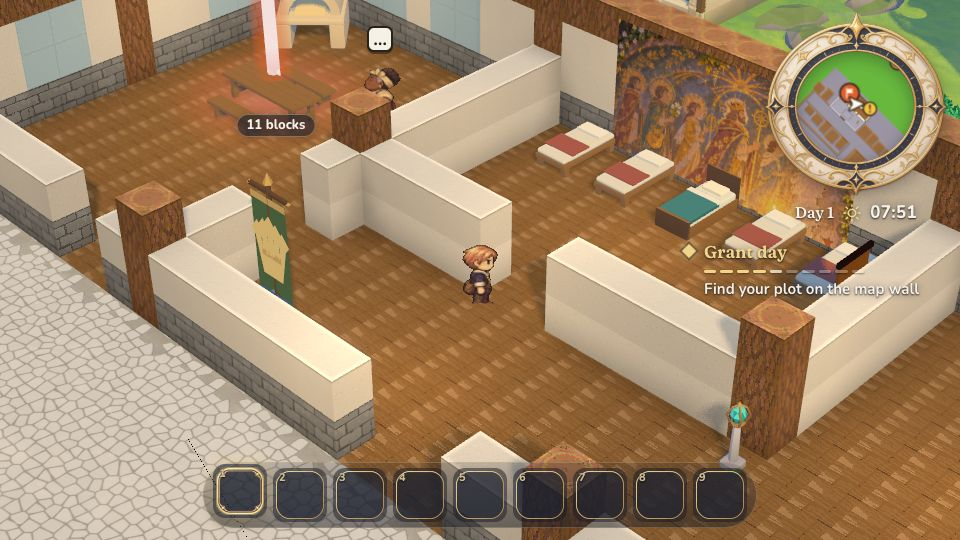
- **question** Step "Take a sword, a bow or a staff from the rack": no marker on the map or the minimap, and no rack in sight from the middle room. The ! that led to the lock and the map wall is gone.  
  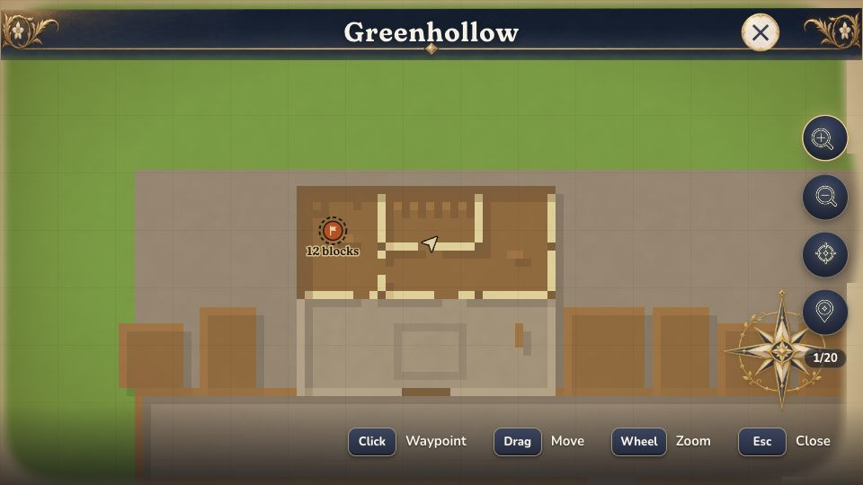
- **question** After a waypoint on the map and Escape twice, then holding S, the rack's choice "A sword, a bow and a staff" opened with the hero still in the hall, about 13 blocks from the rack in the yard, and the camera zoomed right in  
  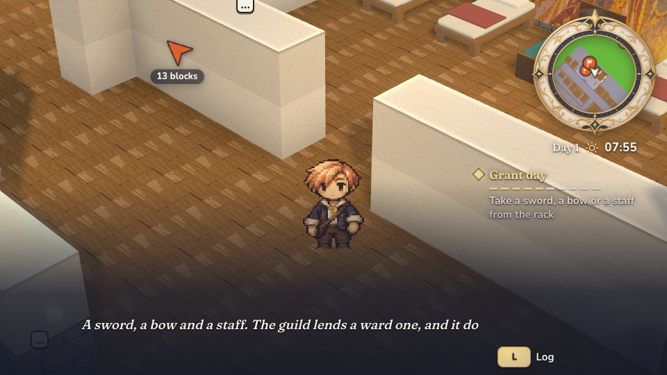
- **bug** With the rack's three choices up, the narrator line "A sword, a bow and a staff..." moves up to y 279 and is drawn over the quest tracker's "Take a sword, a bow or a staff from the rack": both unreadable where they cross (the tool lists the tracker text under span.gb-dialogue-typed)  
  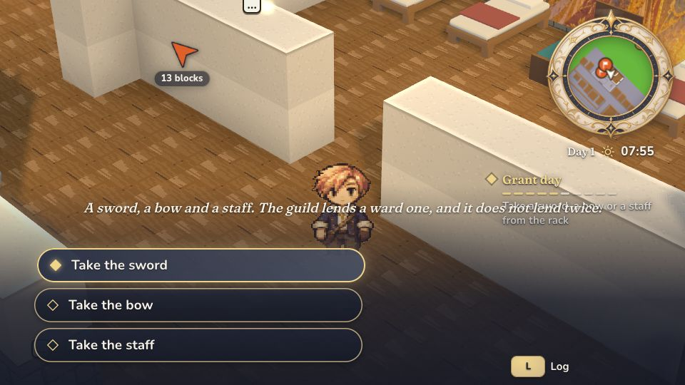
- **polish** Dax and his three guard pips stand at the bottom of the screen with the quick-slot bar over his body when the bout begins  
  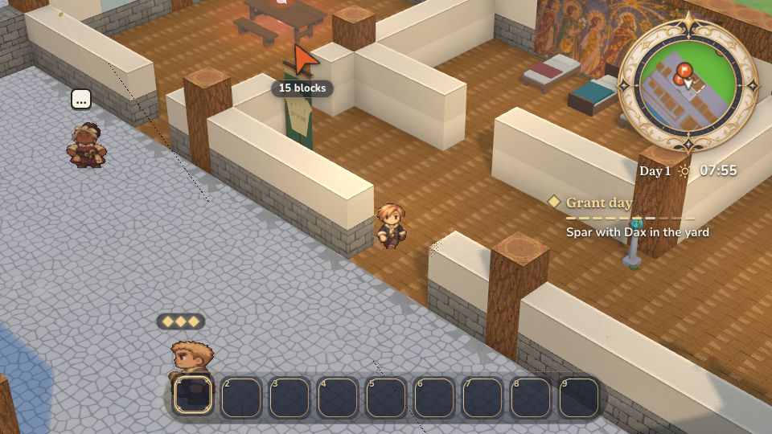
- **bug** Pressing E to continue the Guildmaster's grant lines, as the dialogue box says, typed "e" into the deed's name field when the deed opened: the deed shows the name "e" ready to sign. The tracker already reads "Go down to the quay" before the deed is signed.  
  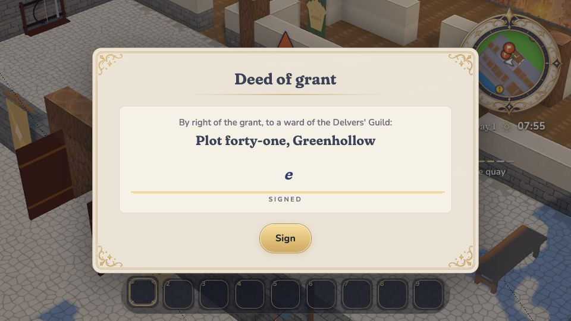
- **polish** On signing the deed, Dax, the Guildmaster and the whole crowd in the yard are gone in the same frame; the yard is empty. Also the staff taken from the rack is not in the hand or the bag, and the clock has stood at 07:55 since the rack.  
  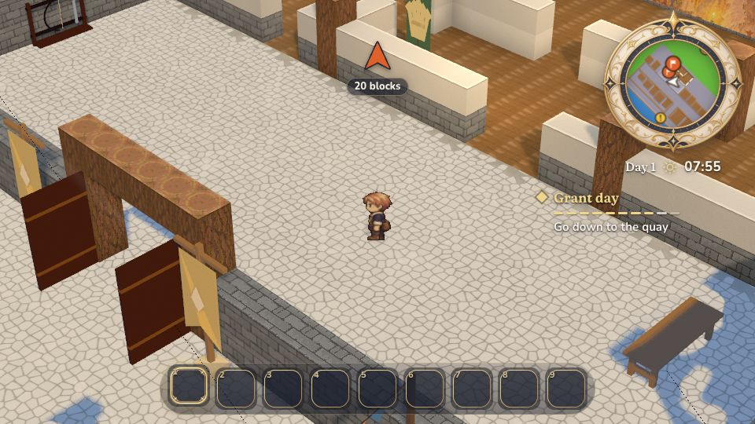
- **question** Leaving the guild yard for the quay took about ten tries: the gate is behind the camera's view of the yard wall, the walls hide the hero, and nothing on screen points to the way out. The quay marker shows on the minimap only.  
  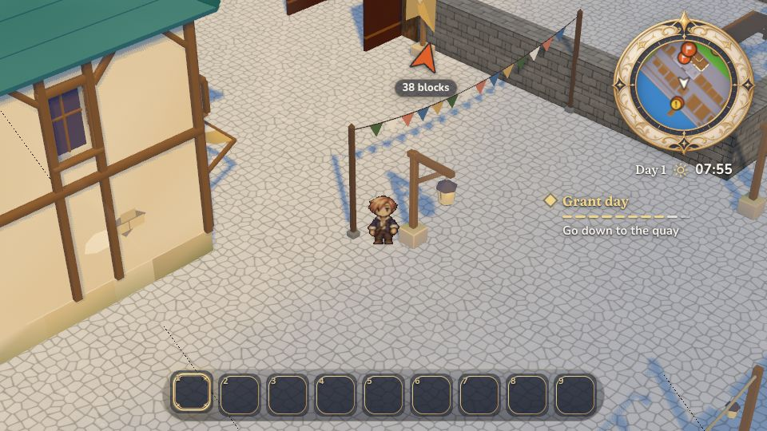
- **polish** Walking the street to the quay, a house front fills the screen for one frame and is gone (film 048 at 1.0 s and 9.6 s): the house that steps aside for the camera pops instead of fading  
  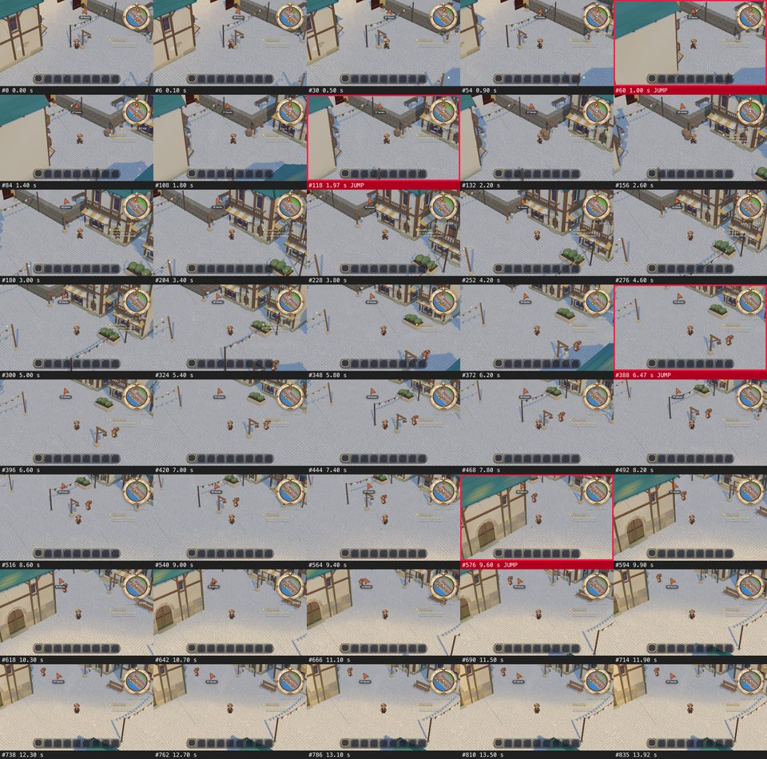
- **bug** The first ferry shot (the marsh) cuts back and forth for about 0.2 s between the river and a view from inside a wood of trees (film 050, frames 181-192 at 3.08-3.28 s) before it settles  
  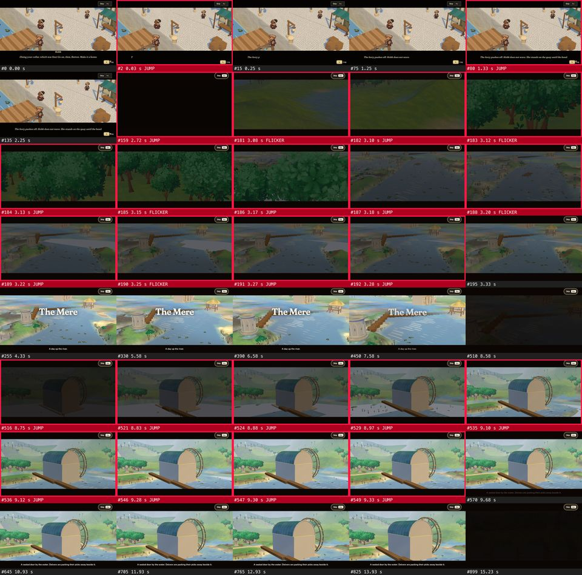
- **question** The ferry's Pump House shot shows a plain box with a barrel roof and a wheel, while the caption says "A sealed door by the water. Delvers are packing their picks away beside it.": no door and no delvers are on the screen (frame 705)  
  
- **question** At the landing the first step of "Ground nobody wanted" is "Dig a ditch from the pond to your dry field", but the bag and the quick slots are empty: no spade, and not the staff taken from the rack either. A marker 119 blocks off is the only lead.  
  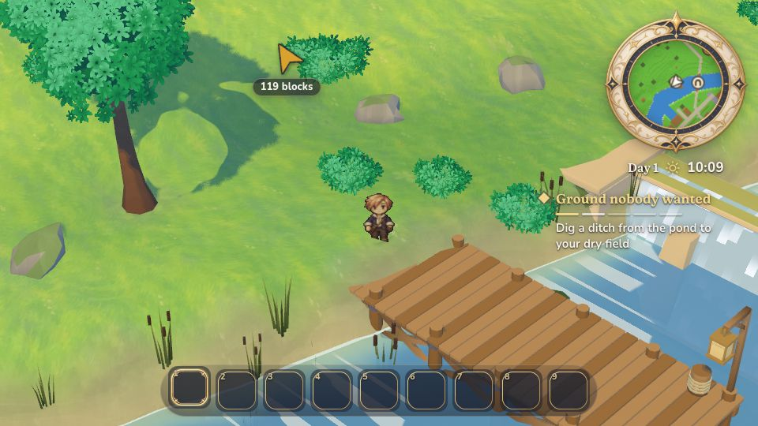
